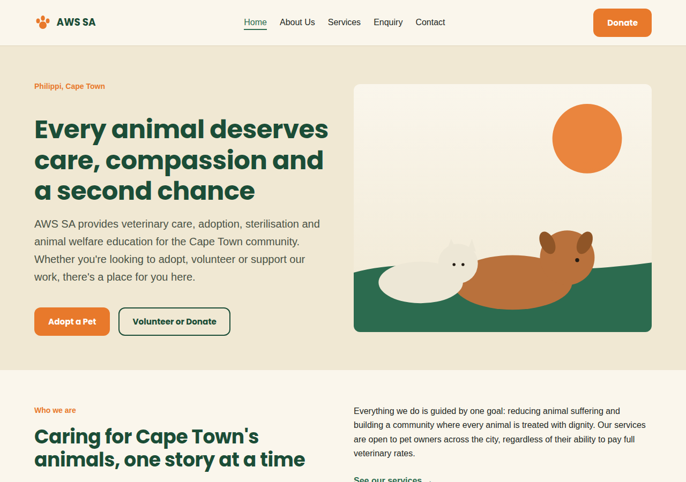
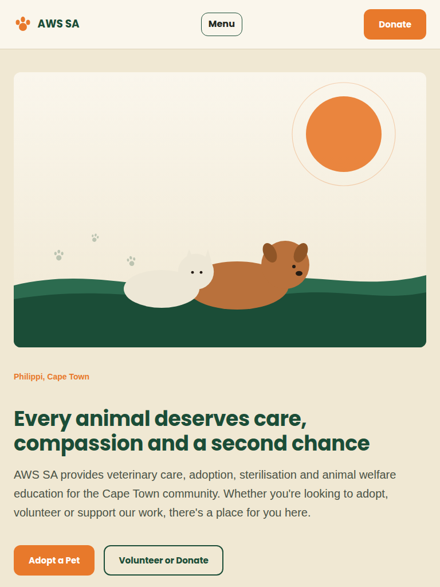
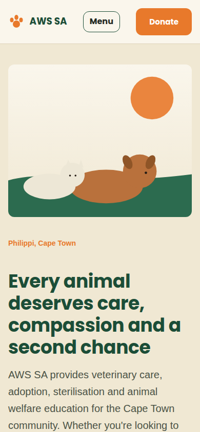

# AWS SA Website: Animal Welfare Society of South Africa

**Student:** Masego Leeuw
**Student number:** ST10530142
**Module:** Web Development
**Live site:** https://chimerical-paprenjak-44c82b.netlify.app/
**GitHub repository:** https://github.com/websiteiceboy/aws-sa-website-

---

## Project Overview

This project is a redesigned website for the Animal Welfare Society of South Africa (AWS SA), an organisation based in Philippi, Cape Town. AWS SA provides veterinary services, animal adoption, sterilisation programmes, and animal welfare education.

The current AWS SA website contains relevant information about the organisation's services and donation options. The redesign focuses on a clearer navigation system, stronger visuals, better organisation of information, and more prominent calls to action such as Adopt, Donate, Volunteer and Sponsor.

The website was built in three parts:

- **Part 1:** Project proposal and planning
- **Part 2:** CSS styling and responsive design
- **Part 3:** JavaScript functionality, SEO and deployment

## Website Goals and Objectives

The primary objectives are to educate, inform, empower and engage the organisation's stakeholders. Specifically, the website aims to:

- raise awareness about AWS SA
- encourage animal adoptions
- recruit volunteers, sponsors and donors
- inform the public about veterinary and animal welfare services
- provide a clear, modern and user-friendly online platform

## Key Features and Functionality

- Five pages: Home, About Us, Services, Enquiry and Contact
- Responsive layout for desktop, tablet and mobile
- Dark green, cream and orange theme using Poppins (headings) and Inter (body text)
- Searchable, filterable and sortable services list built with JavaScript
- FAQ accordion on the Services page
- Photo gallery with lightbox on the About page
- Validated enquiry form that returns cost and availability information
- Validated contact form that compiles an email to the organisation
- Two embedded Google Maps on the Contact page
- Scroll animations and an accessible mobile menu

## Sitemap

```
Home (index.html)
├── About Us (about.html)      History, Mission, Vision, Values, Gallery
├── Services (services.html)   Veterinary Care, Adoption, Sterilisation,
│                              Welfare & Education, Service Finder, FAQ
├── Enquiry (enquiry.html)     Adoption, Veterinary, Sterilisation,
│                              Volunteer, Sponsorship
└── Contact (contact.html)     Locations, Maps, Contact Form
```

## Timeline and Milestones

| Milestone | Description | Status |
|---|---|---|
| Part 1 | Project proposal, research, planning and sitemap | Complete |
| Part 2 | HTML structure, external CSS, responsive design | Complete |
| Part 3 | JavaScript, SEO, forms, maps and deployment | Complete |

## Technical Requirements and Budget

The project requires a domain name, web hosting and basic website maintenance. The estimated development and setup budget is approximately R5000 to R8000, excluding optional professional photography or advanced donation systems.

---

## Part 1 Details

Part 1 covered the website project proposal: the organisation overview, website goals, analysis of the existing website, proposed features and design, technical requirements, budget and sitemap. Design decisions made in Part 1 were a dark green, cream and orange animal-welfare theme, a sans-serif typeface (Poppins), and five main pages.

## Part 2 Details

- Created the external stylesheet `css/style.css` and linked it to every page.
- Added a CSS reset, design tokens (CSS custom properties) and a typographic scale using relative units (`rem`, `%`).
- Built layouts with CSS Grid and Flexbox.
- Added visual styling (shadows, borders, colours) and `:hover`, `:focus` and `:active` states.
- Added breakpoints at 1024px (tablet) and 768px (mobile), with multi-column layouts changing to a single column.
- Added a responsive image using `srcset` and `sizes`.

### Responsive Testing

| Desktop (1280px) | Tablet (768px) | Mobile (390px) |
|---|---|---|
|  |  |  |

## Part 3 Details

- **Navigation:** the mobile menu has ARIA attributes, keyboard support (Enter, Space, Escape) and closes after a link is chosen.
- **Animations:** scroll-reveal animations using `IntersectionObserver` and CSS transitions, disabled for users who prefer reduced motion.
- **Accordion (services.html):** FAQ accordion with `aria-expanded`, one panel open at a time.
- **Dynamic content and search (services.html):** services are stored as data and rendered into the DOM with JavaScript, with live search, a category filter and A to Z / Z to A sorting.
- **Gallery with lightbox (about.html):** four-image gallery in an accessible dialog with previous/next buttons, arrow-key navigation, Escape to close and focus return.
- **Google Maps (contact.html):** two embedded maps (Philippi main centre and Khayelitsha outreach stop).
- **Enquiry form (enquiry.html):** service select, name, phone, email, preferred date and message. JavaScript validates name format, email format, South African phone format, future dates and a 10 to 500 character message, with inline error messages. Valid submissions are sent with AJAX (`fetch`) and the user receives a response showing cost and availability for the chosen service.
- **Contact form (contact.html):** name, phone, email, message type and full message. After validation the details are compiled into an email addressed to `admin@awscape.org.za`, which the user reviews and sends through a `mailto:` link.
- **Deployment:** hosted on Netlify at the live link above.

---

## Changelog


### Part 3: New work
- Added `js/main.js` and linked it with `defer` on all five pages.
- Enhanced the mobile navigation with ARIA attributes, keyboard support and auto-close.
- Added scroll-reveal animations using `IntersectionObserver` with a reduced-motion fallback.
- Added the FAQ accordion, the dynamic services list with search, filter and sort, and the gallery lightbox.
- Replaced the Part 2 map placeholder with two embedded Google Maps.
- Rebuilt the enquiry form and contact form with JavaScript validation, error handling, AJAX submission and a compiled email.
- Added SEO elements: unique titles and meta descriptions, keywords, canonical URLs, Open Graph tags, JSON-LD structured data, `robots.txt` and `sitemap.xml`.
- Added performance improvements (`defer`, `loading="lazy"`, font preconnect) and security measures (`_headers` file, referrer policy, input length limits).
- Added accessibility improvements: skip-to-content link, `aria-live` error regions and visible focus states.
- Deployed the site on Netlify and replaced the placeholder URL in canonical tags, `sitemap.xml`, `robots.txt` and this README.

### Part 2
- Created `css/style.css` and linked it to every page.
- Built the HTML structure for all five pages from the Part 1 sitemap.
- Added the CSS reset, design tokens, typography, Grid and Flexbox layouts, visual styling and interaction states.
- Added responsive breakpoints, relative units and a responsive image using `srcset` and `sizes`.
- Tested at desktop, tablet and mobile widths and added screenshots.

### Part 1
- Created the project proposal, content plan and sitemap.

---

## SEO Discussion

**1. What is SEO and what is its purpose?**
Search Engine Optimisation (SEO) is the practice of structuring a website's content and code so that search engines can understand, index and rank it (Google Search Central, 2026). Its purpose is to help people find the site through unpaid results, for example someone searching for "pet adoption Cape Town".

**2. How does SEO improve user experience (UX) and performance?**
Many SEO practices directly improve UX: clear headings and descriptive titles help users scan pages, alt text supports screen-reader users, and responsive layouts make the site usable on phones. Faster loading through deferred scripts and lazy-loaded images reduces waiting time, which also benefits search rankings.

**3. What are the benefits of implementing SEO?**
SEO increases visibility in organic search, brings targeted visitors (adopters, volunteers and donors) without advertising costs, and builds credibility. For a non-profit with a small budget, these results build up over time.

**4. Specific SEO techniques (HTML, CSS and JavaScript)**
HTML: one `<h1>` per page, semantic tags (`<header>`, `<nav>`, `<main>`), descriptive `alt` text and internal links. CSS: media queries in `style.css` make the layout mobile-friendly. JavaScript: `defer` on `js/main.js` stops it blocking page rendering, `loading="lazy"` delays off-screen images, and JSON-LD structured data describes AWS SA as an `AnimalShelter`.

**5. Purpose of HTML meta elements**
Meta elements sit in the `<head>` and give browsers and search engines information that is not displayed on the page. Examples used here: `charset` (text encoding), `viewport` (mobile scaling), `description` (the snippet shown in search results), `robots` (`index, follow` crawler instructions) and Open Graph `og:title` (social media previews).

### Off-page SEO
- **Backlinks:** plan to request links from local veterinary practices, Cape Town community pages and animal welfare directories.
- **Social media:** Open Graph tags let the site preview correctly when shared on Facebook, X and WhatsApp.
- **Local SEO:** Philippi and Cape Town keywords, local business structured data, and a Google Business Profile listing are recommended.

---

## Notes and Assumptions

- **Sample data:** the prices, clinic hours and availability shown in the enquiry form responses (`ENQUIRY_RESPONSES` in `js/main.js`) are illustrative sample figures created for this assignment. They are not taken from AWS SA.
- **AJAX submission:** `FORM_ENDPOINT` in `js/main.js` is empty, so the enquiry form simulates a server response. Setting it to a real endpoint (for example Formspree) enables live submission without any other code changes.
- **Second map location:** the Khayelitsha outreach location is a sample location used to meet the "more than one location" requirement.
- **Images:** all illustrations and icons are original SVG graphics created for this project.

## Deployment

The site is deployed on Netlify at https://chimerical-paprenjak-44c82b.netlify.app/. The source code is in the GitHub repository linked at the top of this document.

---

## References

- Google Search Central. (2026) *SEO Starter Guide*. Available at: https://developers.google.com/search/docs/fundamentals/seo-starter-guide (Accessed: [26 October 2026]).
- Google Fonts. (2026) *Poppins* [font]. Available at: https://fonts.google.com/specimen/Poppins (Accessed: [26 October 2026]).
- Google Fonts. (2026) *Inter* [font]. Available at: https://fonts.google.com/specimen/Inter (Accessed: [26 October 2026]).
- Google. (2026) *Google Maps Embed*. Available at: https://developers.google.com/maps/documentation/embed (Accessed: [26 October 2026]).
- MDN Web Docs. (2026) *CSS Grid Layout*. Available at: https://developer.mozilla.org/en-US/docs/Web/CSS/CSS_grid_layout (Accessed: [26 October 2026]).
- MDN Web Docs. (2026) *Responsive images*. Available at: https://developer.mozilla.org/en-US/docs/Web/HTML/Guides/Responsive_images (Accessed: [26 October 2026]).
- MDN Web Docs. (2026) *Using media queries*. Available at: https://developer.mozilla.org/en-US/docs/Web/CSS/CSS_media_queries/Using_media_queries (Accessed: [26 October 2026]).
- MDN Web Docs. (2026) *IntersectionObserver*. Available at: https://developer.mozilla.org/en-US/docs/Web/API/IntersectionObserver (Accessed: [26 October 2026]).
- MDN Web Docs. (2026) *Using the Fetch API*. Available at: https://developer.mozilla.org/en-US/docs/Web/API/Fetch_API/Using_Fetch (Accessed: [26 October 2026]).
- MDN Web Docs. (2026) *Client-side form validation*. Available at: https://developer.mozilla.org/en-US/docs/Learn_web_development/Extensions/Forms/Form_validation (Accessed: [26 October 2026]).
- Schema.org. (2026) *AnimalShelter*. Available at: https://schema.org/AnimalShelter (Accessed: [26 October 2026]).
- W3C. (2026) *ARIA Authoring Practices Guide: Accordion Pattern*. Available at: https://www.w3.org/WAI/ARIA/apg/patterns/accordion/ (Accessed: [26 October 2026]).

